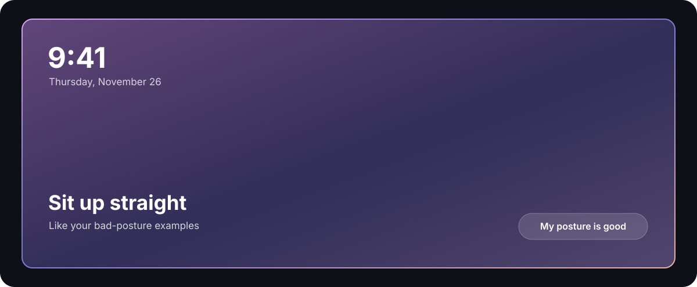
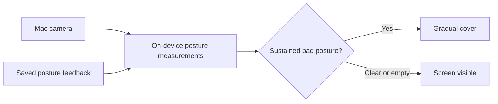

<p align="center"></p>

<p align="center">
  <a href="LICENSE"></a>
  
  
</p>

**Postura** monitors your posture on macOS. It waits for a clearly bad posture to persist, then gradually covers
the display until you correct your posture. The screen clears on the first empty camera detection. Open Postura from the Dock to see
your live camera view, current status, or posture feedback.

Everything runs on the Mac. No camera frames are stored or sent. Postura stores numerical posture examples from the live camera.

## Install

```sh
brew install --cask samihalawa/tap/postura
```

Or install to `~/Applications` with the shell installer.

```sh
curl -fsSL https://raw.githubusercontent.com/samihalawa/postura/main/install.sh | sh
```

Use one installation route. Each [GitHub release](https://github.com/samihalawa/postura/releases/latest) includes
the notarized app and `SHA256SUMS.txt`.

Open **Postura** and allow camera access. The Dock icon opens the Postura window, and the menu bar icon offers the same
basic controls. The first launch sets up a local MediaPipe environment using [uv](https://github.com/astral-sh/uv).
Postura runs on macOS 14 or later on Apple silicon and Intel. It starts at login and continues monitoring when
you close its window.

- **Menu bar**: live posture status, feedback, and Settings.
- **Window** (Dock → Postura): live status and **Good posture** / **Bad posture** feedback. Camera, language, on-screen status, and the optional glasses requirement are in **Settings**.
- **Log**: `~/Library/Logs/postura.log`, one line per decision.

Remove the Homebrew install with `brew uninstall --cask postura`, or remove the shell install with:

```sh
curl -fsSL https://raw.githubusercontent.com/samihalawa/postura/main/install.sh | sh -s uninstall
```

Your examples are kept by default. To delete them and the local logs as well, use Homebrew's `--zap` or the
shell installer's `uninstall --purge`. The shell installer also removes an older shell copy in
`/Applications` when its login service identifies it and Homebrew does not manage it.

## Replay a recording

For offline posture analysis, run `python3 "$RESOURCES/postura-eye.py" --video clip.mov` using the app's Python
environment. Set `RESOURCES` to the app's `Contents/Resources` directory. Rows include the video time, posture
score, and reason. To test live detection with a recording, choose **OBS Virtual Camera** in Settings.

## How the cover works

| You | Postura |
|---|---|
| Sit well or turn to a second screen | No new cover appears. A turned head or uncertain reading can’t start a cover. |
| Slouch, tilt your head or shoulders clearly | After 5 seconds of clearly bad posture, a thin glow starts closing in. |
| Keep slouching | The glow closes in over about 5 seconds, frosting the screen behind it, then covers it and blocks mouse, keyboard, Cmd-Tab and Force Quit. |
| Sit up | After 2 seconds of corrected posture, the glow opens back out over about 2.5 seconds. |
| Leave the frame while it is warning | The cover clears when nobody is detected. |
| Are on a video call (FaceTime, Teams, WebRTC in the browser) | Only a faint edge glow, it never blocks. |
| Disagree with it | Press **Ctrl-Opt-Cmd-G** or click **My posture is good**. Postura learns from the live camera and reveals the screen once it detects corrected posture. |



## Teach it your posture

- **Ctrl-Opt-Cmd-B**: "this posture is bad". **Ctrl-Opt-Cmd-G**: "this posture is good".
- Hold the labelled posture until the six-second countdown finishes. Valid measurements become examples in
  `~/Library/Application Support/Postura/examples.jsonl`. Near an example, your labels win over the built-in rules,
  newest first.
- The same feedback buttons are available in the Dock window and menu bar.

The built-in rules only flag clearly bad posture: head sunk towards the shoulders and pushed forward, head rolled more
than 22°, shoulders tilted more than 16°. The UI is in English, or Spanish when that is the Mac's first language
(or pick one in the window).

## Require glasses

Turn on **Require glasses** in Settings and record one live sample **With glasses** and one **Without glasses**.
Once both examples are ready, consistently missing glasses can gradually cover the display. The glasses check is off
by default. Postura saves numerical examples on this Mac.

## How it works



`Postura.app` (Swift, AppKit, Core Animation) owns the camera, the timing and the screens. Two to six frames a second (more while it suspects bad posture)
go to `postura-eye.py`, which runs MediaPipe Pose Landmarker and Face Landmarker and returns a score from 0 (good)
to 1 (bad) with a reason. The glow and frosted screen ease in and out as you change posture. The cover shows the time, the correction
and its feedback action. Feedback and Settings buttons use native macOS Liquid Glass where available.
The cover can show a live cutout inside a glass lens when a single person matches an existing local face reference.
Otherwise the cover shows the coaching message alone.

Telemetry for tuning lives in `~/Library/Logs/postura-features.jsonl` (one row of numbers per second).

**Build from source**: `./build.sh` makes a universal `build/Postura.app` (ad-hoc signed; `SIGN_IDENTITY` and
`NOTARY_*` variables give a Developer ID, notarized build; see the top of the script).

**Strict mode** (optional, for people who want it hard to switch off): `BUNDLE_ID=com.sami.postura ./build.sh` then
`sudo ./mac/install.sh`. Root daemons relaunch the app and restore it if it is deleted or disabled. With strict mode
installed, opening the Homebrew copy simply brings up the strict copy's window.

## Compared with

| | Postura | [Dorso](https://github.com/tldev/dorso) |
|---|---|---|
| Detection | MediaPipe pose + face landmarks: 3D neck, head and shoulder geometry | Apple Vision head position against a calibrated baseline, or AirPods motion |
| Personal | Learns from your own labelled examples (two hotkeys) | One calibration of your upright posture |
| On bad posture | Glow that closes in and finally blocks input | Progressive screen blur |
| Video calls | Detected; never blocks | — |

Dorso is the more polished app, with a settings window, AirPods mode and a signed, notarized download. Postura is for people
who want detection that learns their own posture and an enforcement that cannot just be waved away.

## Limits

- Tested on Apple silicon with macOS 27.3. Local contributor builds use ad-hoc signing by default.
- With multiple faces in view, Postura scores the nearest face.
- Blocking uses kiosk presentation options; the login item restarts it if it quits.

## Credits

- Glow technique: [AppleIntelligenceGlowEffect](https://github.com/jacobamobin/AppleIntelligenceGlowEffect) by Jacob Mobin and
  [IntelligenceGlow](https://github.com/Livsy90/IntelligenceGlow) by Livsy90 (MIT), rebuilt here in Core Animation with an organic, moving shape.
- Pose and face models: [Google MediaPipe](https://github.com/google-ai-edge/mediapipe) (Apache-2.0), bundled in the release.

## Contributing

See [Contributing](CONTRIBUTING.md) for local builds and bug reports.

## License

[MIT](LICENSE)
